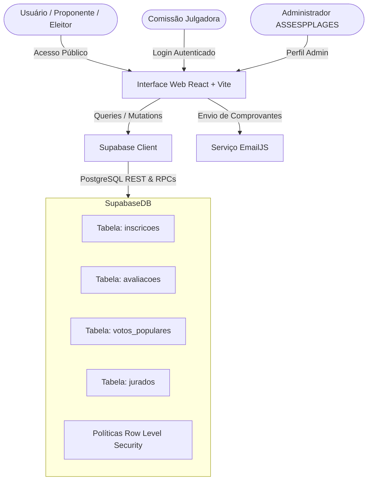

# Prêmio Melhores Práticas do MPPI — 10ª Edição Comemorativa

> **Ministério Público do Estado do Piauí (MPPI)**  
> **Procuradoria-Geral de Justiça**  
> **Assessoria de Planejamento e Gestão (ASSESPPLAGES)**  
> Regulamento: **Edital nº 88/2026**

Sistema institucional integrado para gerenciamento do certame comemorativo dos **10 Anos do Prêmio Melhores Práticas**, englobando submissão de propostas, triagem formal, julgamento técnico pela Comissão Julgadora, votação popular de integrantes da instituição e apuração final de resultados.

---

## Sumário

1. [Visão Geral do Certame](#visão-geral-do-certame)
2. [Módulos e Funcionalidades](#módulos-e-funcionalidades)
3. [Regras de Negócio e Edital nº 88/2026](#regras-de-negócio-e-edital-nº-882026)
4. [Arquitetura e Tecnologias](#arquitetura-e-tecnologias)
5. [Diretrizes Arquiteturais Críticas](#diretrizes-arquiteturais-críticas)
6. [Estrutura do Repositório](#estrutura-do-repositório)
7. [Instalação e Execução Local](#instalação-e-execução-local)
8. [Variáveis de Ambiente](#variáveis-de-ambiente)
9. [Banco de Dados e Migrações](#banco-de-dados-e-migrações)
10. [Documentação Complementar e Suporte](#documentação-complementar-e-suporte)

---

## Visão Geral do Certame

O **Prêmio Melhores Práticas** tem como finalidade identificar, valorizar, premiar e disseminar iniciativas inovadoras e resolutivas concebidas e executadas por membros e servidores do Ministério Público do Estado do Piauí.

### Categorias e Modalidades

- **Categorias (Áreas de Atuação Institucional):**
  - **Área Finalística:** Iniciativas voltadas diretamente à atividade-fim do MPPI (Defesa dos direitos fundamentais, coletivos e difusos, infância, patrimônio público, tutela penal, cidadania, meio ambiente, etc.).
  - **Área Estruturante:** Iniciativas voltadas ao aperfeiçoamento da governança administrativa, suporte operacional, tecnologia da informação, sustentabilidade interna e gestão institucional.
- **Modalidades de Inscrição:**
  - **Prática:** Iniciativa ou conjunto de ações já implementadas com resultados concretos, comprovados e mensuráveis.
  - **Projeto:** Proposta estruturada, formalizada ou institucionalizada que estabelece metodologia com metas, etapas e cronograma.

---

## Módulos e Funcionalidades

### 1. Página Inicial & Acessos Rápidos (`/`)
- Identidade visual institucional sóbria, elegante, com cantos retos e bordas finas e discretas.
- Cabeçalho hero com selo da 10ª Edição e frase inspiradora.
- Cards de acesso rápido direcionando para os principais módulos: *Área do Proponente*, *Portal dos Jurados*, *Regulamento Oficial* (modal interativo com o Edital) e *Votação Popular*.

### 2. Área do Proponente & Acompanhamento Público (`/proponente`, `/login`)
- **Totalmente pública e sem barreiras de autenticação:** como as inscrições são realizadas via formulário eletrônico público, o proponente não necessita criar ou lembrar senhas para acompanhar a seleção.
- **Painel de Status:** Indicação clara da fase vigente (*Inscrições Encerradas • Triagem e Habilitação*).
- **Linha do Tempo Oficial:** Acompanhamento visual das 8 etapas do certame (da submissão à solenidade de premiação).
- **Critérios da Comissão Julgadora:** Apresentação detalhada dos 5 critérios avaliativos (0 a 5 pontos inteiros cada, totalizando até 25 pontos por jurado).
- **Orientações para Recursos:** Instruções e prazos regulamentares para interposição de **Pedidos de Reconsideração** (22 a 26/10/2026).
- **Canais de Contato:** Informações oficiais de suporte da ASSESPPLAGES (`planejamento@mppi.mp.br`).

### 3. Portal dos Jurados & Avaliação Técnica (`/admin/login`, `/jurado/*`)
- Autenticação restrita e verificação de perfil de jurado (`has_role('jurado')`).
- Visualização e filtragem dos trabalhos habilitados por área de julgamento atribuída.
- Ficha de avaliação técnica detalhada baseada nos 5 critérios estabelecidos no Edital nº 88/2026.
- Inserção de notas inteiras de 0 a 5 com escala descritiva e emissão de parecer técnico individual por iniciativa.
- Painel individual de acompanhamento do progresso das avaliações do jurado.

### 4. Votação Popular Institucional (`/voto-popular`)
- Votação aberta e direta para todos os integrantes em exercício no MPPI (membros e servidores).
- **Validação de Voto:** Autenticação institucional por e-mail `@mppi.mp.br` e matrícula funcional.
- **Mecanismo Anti-Duplicidade:** Regra estrita de 1 voto por integrante, com conferência em banco de dados e auditoria de submissão.
- Disputa restrita aos **3 (três) trabalhos finalistas com maiores médias técnicas** de cada categoria.

### 5. Painel Administrativo do Certame (`/admin/*`)
- **Gestão de Inscrições:** Triagem, deferimento preliminar, análise de pedidos de reconsideração e homologação definitiva de inscritos.
- **Gestão da Comissão Julgadora:** Cadastro de jurados, designação de áreas e monitoramento de notas atribuídas.
- **Apuração e Consolidação de Notas:** Relatórios automatizados por categoria e por jurado, com conversão para a escala 0 a 100.
- **Cálculo da Média Ponderada Final:** Aplicação da fórmula oficial do Edital: **80% Nota Técnica + 20% Voto Popular**.
- **Gestão de Cronograma e Regulamento:** Atualização dinâmica de datas e normas do certame.

---

## Regras de Negócio e Edital nº 88/2026

O sistema incorpora integralmente os preceitos do **Edital nº 88/2026**:

### Critérios de Avaliação Técnica (Item 4.1 do Edital)
Todos os critérios possuem **igual valor** (pesos iguais), sem diferenciação de peso entre si:
1. **I — Cooperação (0 a 5 pontos):** Grau de articulação e de colaboração entre unidades do MPPI, instituições parceiras ou organizações da sociedade civil.
2. **II — Inovação (0 a 5 pontos):** Adoção de solução, método, processo, ferramenta ou forma de atuação nova ou significativamente aperfeiçoada, capaz de produzir ganho de qualidade, eficiência ou desempenho.
3. **III — Resolutividade (0 a 5 pontos):** Capacidade da iniciativa de solucionar, prevenir, reduzir ou enfrentar de maneira concreta o problema que motivou sua implementação.
4. **IV — Impacto Social ou Institucional (0 a 5 pontos):** Dimensão, relevância e profundidade das mudanças produzidas para a sociedade, para o público beneficiado ou para o funcionamento da Instituição.
5. **V — Replicabilidade (0 a 5 pontos):** Possibilidade de a iniciativa ser reaplicada ou adaptada em outras unidades, áreas ou contextos institucionais, considerando sua viabilidade prática e seu potencial de produzir resultados semelhantes.

### Escala Oficial de Notas (Item 4.2 do Edital)
- `0 ponto`: Critério não demonstrado.
- `1 ponto`: Atendimento incipiente.
- `2 pontos`: Atendimento parcial ou pouco consistente.
- `3 pontos`: Atendimento satisfatório.
- `4 pontos`: Atendimento relevante e bem demonstrado.
- `5 pontos`: Atendimento excelente, amplamente demonstrado por dados, resultados ou evidências.
- **Pontuação máxima atribuível por jurado:** **25 pontos** (Item 4.3).

### Fórmula de Apuração do Resultado Final (Item 8 do Edital)
- **Nota Técnica (NT):** Média aritmética das notas válidas da Comissão Julgadora convertida para a escala de **0 a 100** (Item 8.3).
- **Nota do Voto Popular (NVP):** Média proporcional obtida na votação institucional na escala de **0 a 100**.
- **Nota Final (NF):** Composição ponderada:
  $$\text{Nota Final (NF)} = (\text{NT} \times 0{,}80) + (\text{NVP} \times 0{,}20)$$

---

## Arquitetura e Tecnologias



### Tecnologias Utilizadas

- **Frontend Core:** [React 18](https://react.dev/), [TypeScript](https://www.typescriptlang.org/), [Vite](https://vitejs.dev/)
- **Estilização & Design System:** [Tailwind CSS](https://tailwindcss.com/), Radix UI / [shadcn-ui](https://ui.shadcn.com/)
- **Ícones & Animações:** [Lucide React](https://lucide.dev/), `tailwindcss-animate`
- **Backend & Database:** [Supabase](https://supabase.com/) (PostgreSQL 15+, Auth, Row Level Security, Database Functions & RPCs)
- **Geração de Documentos:** [jsPDF](https://github.com/parallax/jsPDF), [html2canvas](https://html2canvas.hertzen.com/)
- **Notificações por E-mail:** [@emailjs/browser](https://www.emailjs.com/)
- **Gerenciamento de Estado de Dados:** [@tanstack/react-query](https://tanstack.com/query/latest)

---

## Diretrizes Arquiteturais Críticas

O projeto segue regras estritas estabelecidas em [AGENTS.md](./AGENTS.md):

1. **Cliente Supabase Anônimo Sessionless:**
   - O cliente Supabase anônimo deve permanecer `sessionless` para que submissões públicas de fichas de inscrição e votos não compartilhem, modifiquem ou sobrescrevam a sessão de contas administrativas ou de jurados autenticados.
2. **Identificador de Conta como UUID Plano:**
   - O identificador de proponente (`user_id`) é armazenado como um campo UUID padrão sem chave estrangeira estrita ou dependência rígida com tabelas internas de autenticação gerenciadas pelo Supabase (`auth.users`).
3. **Tipos Dedicados para Resumos de Finalistas Públicos:**
   - As interfaces públicas da votação popular utilizam tipos dedicados de exibição, omitindo notas privadas, identificadores internos de jurados e campos de avaliação restritos.

---

## Estrutura do Repositório

```
mppi-pratics-inscricao/
├── .env.example                  # Modelo de variáveis de ambiente
├── AGENTS.md                     # Regras e restrições arquiteturais para agentes e desenvolvedores
├── README.md                     # Documentação principal do projeto
├── components.json               # Configuração dos componentes shadcn-ui
├── package.json                  # Dependências e scripts npm
├── tailwind.config.ts            # Configuração do Tailwind CSS e tokens visuais
├── tsconfig.json                 # Configuração do TypeScript
├── vite.config.ts                # Configuração do bundler Vite
│
├── docs/                         # Documentação técnica e manuais complementares
│   ├── README.md                 # Índice da documentação
│   ├── CONFIGURACAO_EMAIL.md     # Guia de configuração de e-mails transacionais
│   ├── CONFIGURACAO-EMAILJS.md   # Configuração detalhada do serviço EmailJS
│   ├── INSTRUCOES_SUPABASE.md    # Configurações de banco de dados e RLS
│   └── roadmap.md                # Cronograma técnico de lançamentos
│
├── scripts/                      # Scripts e utilitários auxiliares
│   ├── README.md                 # Explicação dos scripts de manutenção
│   ├── sql/                      # Scripts SQL manuais para execução no Supabase SQL Editor
│   └── debug/                    # Páginas HTML e scripts Node de teste e diagnóstico
│
├── public/                       # Arquivos estáticos (logos, brasão MPPI, favicons)
│
├── src/                          # Código-fonte da aplicação
│   ├── App.tsx                   # Roteamento e provedores globais da aplicação
│   ├── index.css                 # Design system base, variáveis HSL e tokens de borda/raio
│   ├── main.tsx                  # Ponto de entrada React
│   │
│   ├── components/               # Componentes reutilizáveis de interface
│   │   ├── ui/                   # Primitivos de UI estilizados (Button, Card, Badge, Dialog, etc.)
│   │   ├── InscricaoForm.tsx     # Formulário eletrônico de inscrição pública
│   │   ├── InscricoesEncerradas.tsx # Página inicial (após encerramento do prazo de inscrição)
│   │   ├── TopNav.tsx            # Barra de navegação superior para usuários autenticados
│   │   └── JuryManagement.tsx    # Componente administrativo de gestão da comissão julgadora
│   │
│   ├── pages/                    # Páginas e rotas da aplicação
│   │   ├── Index.tsx             # Rota raiz (/)
│   │   ├── AreaProponente.tsx    # Painel público de acompanhamento do proponente (/proponente)
│   │   ├── VotoPopular.tsx       # Votação popular institucional aberta (/voto-popular)
│   │   ├── AdminLogin.tsx        # Login administrativo e comissão julgadora (/admin/login)
│   │   ├── AdminHome.tsx         # Dashboard administrativo
│   │   ├── AdminCategorias.tsx   # Painel de iniciativas por categoria e triagem
│   │   ├── AdminJulgamento.tsx   # Gestão do processo de julgamento técnico
│   │   ├── AdminAvaliacao.tsx    # Tela de avaliação técnica da iniciativa
│   │   ├── AdminRelatorioCategoria.tsx # Relatório consolidado por categoria
│   │   ├── AdminRelatorioJurados.tsx   # Relatório consolidado por jurado
│   │   ├── AdminPremiacao.tsx    # Painel de apuração final e premiação
│   │   └── AdminRegulamento.tsx  # Consulta e edição administrativa do regulamento
│   │
│   ├── lib/                      # Serviços de dados, autenticação e regras de negócio
│   │   ├── adminService.ts       # Operações administrativas e triagem de inscritos
│   │   ├── evaluationService.ts  # Cálculos de notas e persistência de avaliações dos jurados
│   │   ├── votoPopularService.ts # Processamento e validação de votos populares
│   │   ├── supabaseService.ts    # Funções de acesso a dados da tabela inscricoes
│   │   ├── auth.ts               # Utilitários de autenticação e verificação de papéis (roles)
│   │   └── pdfGenerator.ts       # Geração de comprovantes e fichas em PDF
│   │
│   └── integrations/supabase/    # Cliente oficial do Supabase e tipagens TypeScript geradas
│
└── supabase/                     # Configuração oficial da infraestrutura Supabase
    ├── config.toml               # Configuração local da CLI do Supabase
    └── migrations/               # Histórico versionado de migrações SQL da base de dados
```

---

## Instalação e Execução Local

### Pré-requisitos
- **Node.js**: Versão 18.x ou superior recomendada.
- **npm** (incluso com Node) ou **bun**.

### Passo a Passo

1. **Clonar o Repositório:**
   ```bash
   git clone git@github.com:nayrahmachadoadm-coder/mppi-pratics-inscricao.git
   cd mppi-pratics-inscricao
   ```

2. **Instalar Dependências:**
   ```bash
   npm install
   ```

3. **Configurar as Variáveis de Ambiente:**
   Crie um arquivo `.env` na raiz do projeto com as chaves do Supabase e do EmailJS (veja a seção [Variáveis de Ambiente](#variáveis-de-ambiente)).

4. **Iniciar o Servidor de Desenvolvimento:**
   ```bash
   npm run dev
   ```
   Acesse a aplicação no navegador em `http://localhost:8080` (ou na porta indicada pelo terminal).

5. **Gerar Build de Produção:**
   ```bash
   npm run build
   ```

6. **Testar Build Localmente (Preview):**
   ```bash
   npm run preview
   ```

---

## Variáveis de Ambiente

Crie o arquivo `.env` na raiz do projeto com base no modelo abaixo:

```env
# Conexão com o Supabase
VITE_SUPABASE_URL=https://<seu-projeto>.supabase.co
VITE_SUPABASE_ANON_KEY=eyJhbGciOi...sua-chave-anon-publica...

# Configurações do EmailJS (Notificações de Inscrição)
VITE_EMAILJS_SERVICE_ID=service_mppi
VITE_EMAILJS_TEMPLATE_ID=template_inscricao
VITE_EMAILJS_PUBLIC_KEY=sua_chave_publica_emailjs
```

---

## Banco de Dados e Migrações

O banco de dados é gerenciado via Supabase PostgreSQL:

- **Migrações Oficiais Versionadas:** Localizadas em `supabase/migrations/`. Para aplicar novas migrações via CLI:
  ```bash
  supabase db push
  ```
- **Políticas de Segurança (Row Level Security):**
  - Inscrições públicas são controladas pela política `inscricoes_public_insert`.
  - Consultas e atualizações de avaliações são restritas a usuários autenticados com o papel correspondente (`jurado` ou `admin`).
- **Scripts de Manutenção:** Caso necessite aplicar procedimentos manuais ou rotinas de auditoria, consulte `scripts/sql/` e o guia `docs/INSTRUCOES_SUPABASE.md`.

---

## Documentação Complementar e Suporte

- **Instruções de E-mail:** [docs/CONFIGURACAO_EMAIL.md](./docs/CONFIGURACAO_EMAIL.md) e [docs/CONFIGURACAO-EMAILJS.md](./docs/CONFIGURACAO-EMAILJS.md)
- **Instruções de Banco de Dados:** [docs/INSTRUCOES_SUPABASE.md](./docs/INSTRUCOES_SUPABASE.md)
- **Roadmap do Projeto:** [docs/roadmap.md](./docs/roadmap.md)
- **Regras para Agentes e IA:** [AGENTS.md](./AGENTS.md)

### Contato Institucional
- **Órgão Responsável:** Assessoria de Planejamento e Gestão (ASSESPPLAGES)
- **Instituição:** Ministério Público do Estado do Piauí (MPPI)
- **E-mail Oficial:** [planejamento@mppi.mp.br](mailto:planejamento@mppi.mp.br)
